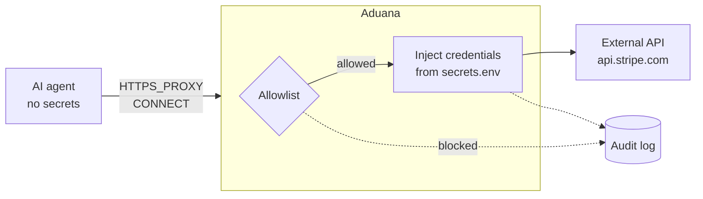

# Aduana

**Egress traffic filter and proxy for AI agents that injects credentials into outgoing HTTPS requests.**

Give your agents access to the APIs they need without ever handing them the keys. Aduana sits between your self-hosted servers and the internet: it blocks everything you have not allowed, inspects HTTPS traffic and injects the secrets in flight, so a compromised agent has nothing to leak. A lightweight proxy in a single Rust binary.

- **Explicit allowlist**: blocks all unauthorized outbound traffic by default.
- **Credential injection**: adds or replaces headers on the way out, so API secrets never reach the clients.
- **HTTPS inspection**: terminates TLS with an internal CA that your servers trust.
- **Logging and auditing**: records allowed requests and blocked attempts.



## Installing

On an amd64 Linux server with `systemd`, `curl` and `openssl`:

```bash
curl -fsSL https://github.com/albersola/aduana/releases/latest/download/install.sh \
  | sudo bash -s -- --listen 10.0.10.5:3128
```

`--listen` is the **internal** address your clients connect to. Do not expose it to the internet or put another proxy in front: clients are identified by their source IP.

The installer prints how to configure each client.

## Updating

```bash
curl -fsSL https://github.com/albersola/aduana/releases/latest/download/install.sh | sudo bash
```

Your configuration is kept, and the previous version is restored if the new one does not start. For a specific version, use `sudo bash -s -- --version 0.1.0`.

## Configuration

| File | Contents |
| --- | --- |
| `/etc/aduana/rules.conf` | Clients and rules. See [docs/rules.md](docs/rules.md) and [rules.example.conf](rules.example.conf). |
| `/etc/aduana/secrets.env` | Secrets used by the rules. |
| `/etc/aduana/aduana.env` | Listen address. Change it by running the installer with `--listen`. |
| `/etc/aduana/ca.crt` | CA certificate to install on the clients. |

Write one secret per line in `secrets.env` and use it in the rules as `${secret.stripe_key}`:

```bash
stripe_key=sk_live_xxxxxxxx
```

Secrets only work with HTTPS destinations without wildcards. Apply any change with:

```bash
sudo aduana check --secrets-file /etc/aduana/secrets.env
sudo aduana apply
```

## Other commands

```bash
sudo aduana test --from web-01 POST https://api.stripe.com/v1/charges   # simulate a request
sudo aduana log --client web-01 --limit 20                              # logged traffic
sudo aduana denied --limit 20                                           # blocked attempts
```

## Publishing a release

Publish a GitHub release with a new tag such as `0.2.0`. It stays as a draft until its files are built and attached.

## License

[MIT](LICENSE)
